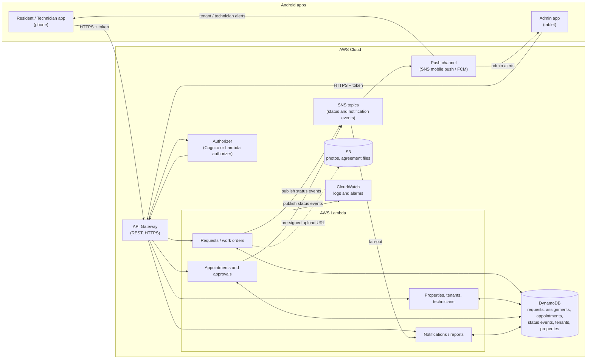

# Fix-it Technical Architecture (Proposed)

Status: **Proposed.** Nothing below is implemented. The resident/technician phone app and the admin tablet app currently use local mock data and do not connect to AWS.

## Overview

Request flow: resident or technician app -> API Gateway -> Lambda -> DynamoDB -> SNS -> admin app. The admin app uses the same API.

## Design Decisions to Confirm

- **Authorization:** API Gateway needs an authorizer (for example Cognito groups for resident, technician, and admin). Each Lambda must enforce role and ownership; hiding screens in the apps is not security.
- **Notification delivery:** SNS publishes and fans out events. Reaching phones requires SNS mobile push (FCM for Android) or API polling. Provider choice is undecided.
- **Admin-only events:** a technician rejection goes only to the admin topic or subscription; the tenant keeps the Pending / In Progress status.
- **Files:** photos and agreement files go to S3 through pre-signed URLs. DynamoDB stores only the file reference.
- **DynamoDB:** status events and notification attempts are append-only items so history is never overwritten.

## Related Documents

- `docs/admin_doc/admin_data_contract.md` for the backend-neutral entity model.
- `docs/admin_doc/admin_implementation_plan.md` for admin stage status (A3 backend is on hold).
